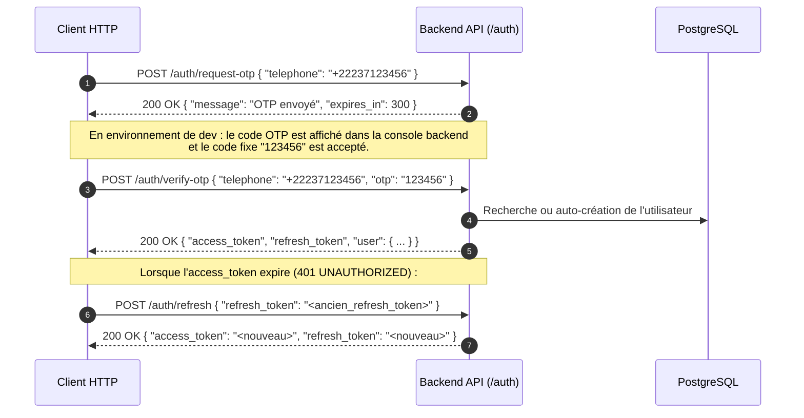

# Documentation API Backend — Foncier Mauritanie (MPX)

> **Version de l'API :** `v1`  
> **Stack Backend :** Java 17 · Spring Boot · PostgreSQL 17 / PostGIS 3.5 · Spring Security JWT  
> **Destinataires :** Équipes Frontend (React Native & Angular) et Backend  
> **Prérequis Base de Données (PostgreSQL / PostGIS / Requêtes SQL) :** voir [DATABASE_SETUP.md](./DATABASE_SETUP.md)

---

## Sommaire

1. [Conventions Générales & Configuration](#1-conventions-générales--configuration)
2. [Flux d'Authentification OTP (Vue d'ensemble)](#2-flux-dauthentification-otp-vue-densemble)
3. [Endpoints d'Authentification (`/auth`)](#3-endpoints-dauthentification-auth)
   - [3.1 Demander un code OTP (`POST /auth/request-otp`)](#31-demander-un-code-otp)
   - [3.2 Vérifier le code OTP & Se connecter (`POST /auth/verify-otp`)](#32-vérifier-le-code-otp--se-connecter)
   - [3.3 Rafraîchir la session (`POST /auth/refresh`)](#33-rafraîchir-la-session-rotation-du-refresh-token)
   - [3.4 Fermer la session (`POST /auth/logout`)](#34-fermer-la-session)
4. [Endpoints Utilisateurs, Profils, Rôles & KYC (`/users/me`)](#4-endpoints-utilisateurs-profils-rôles--kyc-usersme)
   - [4.1 Récupérer mon profil (`GET /users/me`)](#41-récupérer-mon-profil)
   - [4.2 Mettre à jour mon profil (`PUT /users/me`)](#42-mettre-à-jour-mon-profil)
   - [4.3 Téléverser ma photo de profil (`POST /users/me/photo`)](#43-téléverser-ma-photo-de-profil)
   - [4.4 Changer de rôle (`PUT /users/me/role`)](#44-changer-de-rôle)
   - [4.5 Soumettre les documents KYC (`POST /users/me/kyc`)](#45-soumettre-les-documents-kyc)
   - [4.6 Enregistrer un token push FCM/APNs (`PUT /users/me/device`)](#46-enregistrer-un-token-push-fcmapns)
5. [Endpoints Biens Immobiliers, Recherche PostGIS & Favoris (`/properties` & `/users/me`)](#5-endpoints-biens-immobiliers-recherche-postgis--favoris-v1properties--usersme)
   - [5.1 Catalogue public & recherche multicritère (`GET /properties`)](#51-catalogue-public--recherche-multicritère)
   - [5.2 Biens en vedette (`GET /properties/featured`)](#52-biens-en-vedette)
   - [5.3 Biens à proximité GPS PostGIS (`GET /properties/nearby`)](#53-biens-à-proximité-gps-postgis)
   - [5.4 Détail complet d'un bien (`GET /properties/:id`)](#54-détail-complet-dun-bien)
   - [5.5 Créer un bien (`POST /properties`)](#55-créer-un-bien)
   - [5.6 Modifier un bien (`PUT /properties/:id`)](#56-modifier-un-bien)
   - [5.7 Téléverser des photos de bien (`POST /properties/:id/photos`)](#57-téléverser-des-photos-de-bien)
   - [5.8 Modérer / Publier le statut d'un bien (`PATCH /properties/:id/status`)](#58-modérer--publier-le-statut-dun-bien)
   - [5.9 Lister mes biens (`GET /users/me/properties`)](#59-lister-mes-biens)
   - [5.10 Gérer mes favoris (`POST`, `DELETE`, `GET /users/me/favorites`)](#510-gérer-mes-favoris)
   - [5.11 Téléverser un document foncier (`POST /properties/:id/documents`)](#511-téléverser-un-document-foncier)
6. [Endpoints Déverrouillages des Coordonnées (`/properties/:id/unlock` & `/users/me/unlocks`)](#6-endpoints-déverrouillages-des-coordonnées)
   - [6.1 Déverrouiller les coordonnées d'un bien (`POST /properties/:id/unlock`)](#61-déverrouiller-les-coordonnées-dun-bien)
   - [6.2 Historique de mes déverrouillages (`GET /users/me/unlocks`)](#62-historique-de-mes-déverrouillages)
7. [Endpoints Notifications In-App (`/notifications`)](#7-endpoints-notifications-in-app-notifications)
   - [7.1 Lister mes notifications (`GET /notifications`)](#71-lister-mes-notifications)
   - [7.2 Marquer une notification comme lue (`PATCH /notifications/:id/read`)](#72-marquer-une-notification-comme-lue)
   - [7.3 Tout marquer comme lu (`POST /notifications/read-all`)](#73-tout-marquer-comme-lu)
8. [Endpoints Abonnements, Plans & Factures (`/plans`, `/subscriptions` & `/users/me`)](#8-endpoints-abonnements-plans--factures)
   - [8.1 Liste publique des plans (`GET /plans`)](#81-liste-publique-des-plans)
   - [8.2 Souscrire à un plan (`POST /subscriptions`)](#82-souscrire-à-un-plan)
   - [8.3 Consulter mon abonnement actif (`GET /users/me/subscription`)](#83-consulter-mon-abonnement-actif)
   - [8.4 Historique de mes factures (`GET /users/me/invoices`)](#84-historique-de-mes-factures)
9. [Endpoints Mandats Immobiliers (`/mandats`)](#9-endpoints-mandats-immobiliers-mandats)
   - [9.1 Lister mes mandats (`GET /mandats`)](#91-lister-mes-mandats)
   - [9.2 Créer un mandat (`POST /mandats`)](#92-créer-un-mandat)
   - [9.3 Modifier le statut d'un mandat (`PATCH /mandats/:id/status`)](#93-modifier-le-statut-dun-mandat)
10. [Endpoints Opérations & Missions Terrain (`/missions`)](#10-endpoints-opérations--missions-terrain-missions)
    - [10.1 Lister les missions (`GET /missions`)](#101-lister-les-missions)
    - [10.2 Assigner une mission terrain (`POST /missions`)](#102-assigner-une-mission-terrain-back-office)
    - [10.3 Détail d'une mission & bien associé (`GET /missions/:id`)](#103-détail-dune-mission--bien-associé)
    - [10.4 Exécuter / Clôturer une mission (`PATCH /missions/:id`)](#104-exécuter--clôturer-une-mission)
    - [10.5 Téléverser les photos de vérification (`POST /missions/:id/photos`)](#105-téléverser-les-photos-de-vérification)
11. [Documentation Interactive OpenAPI / Swagger UI (`/api/docs`)](#11-documentation-interactive-openapi--swagger-ui-apidocs)
12. [Structure des Tokens JWT & Objet `User`](#12-structure-des-tokens-jwt--objet-user)
13. [Format Standardisé des Erreurs & Localisation (`fr` / `ar`)](#13-format-standardisé-des-erreurs--localisation-fr--ar)
14. [Enveloppe de Pagination & Coordonnées GPS](#14-enveloppe-de-pagination--coordonnées-gps)

---

## 1. Conventions Générales & Configuration

### URLs de base
| Environnement | Base URL |
| :--- | :--- |
| **Développement local** | `http://localhost:8080` *(Swagger UI : `http://localhost:8080/api/docs`)* |
| **Production** | `https://api.fonciermauritanie.mr` |

> **Attention dans Postman / Insomnia :** Veillez à ne pas laisser d'espace à la fin de l'URL (ex. `%20`).

### En-têtes HTTP (Headers)
| Header | Valeur | Obligatoire | Description |
| :--- | :--- | :---: | :--- |
| `Content-Type` | `application/json` | Oui | Pour toutes les requêtes avec un corps JSON (`multipart/form-data` pour les fichiers) |
| `Authorization` | `Bearer <access_token>` | Routes protégées | Jeton JWT d'accès (durée de vie : **1 heure**) |
| `Accept-Language` | `fr` ou `ar` | Optionnel | Défaut : `fr`. Permet d'obtenir les messages d'erreur traduits en français ou en arabe |

### Règles de formatage JSON
* **Casse des propriétés :** Tous les champs JSON en entrée et en sortie utilisent strictement le format **`snake_case`**.
* **Dates & Horodatages :** Format **ISO 8601 UTC** (`2026-10-23T21:00:00Z`).
* **Identifiants :** Tous les identifiants sont des **UUID v4** (`"550e8400-e29b-41d4-a716-446655440000"`).

---

## 2. Flux d'Authentification OTP (Vue d'ensemble)

L'authentification s'effectue **sans mot de passe** en 2 étapes par SMS OTP. Si le numéro de téléphone n'est pas encore enregistré, **le compte utilisateur est créé automatiquement** lors de la validation du premier code OTP avec le rôle `particulier` et l'abonnement `gratuit`.



---

## 3. Endpoints d'Authentification (`/auth`)

### 3.1 Demander un code OTP

Génère et envoie un code OTP à 6 chiffres valable **5 minutes (300 secondes)**.

* **Méthode & URL :** `POST /auth/request-otp`
* **Accès :** Public
* **Rate Limiting :** Maximum **3 demandes par minute** et par numéro de téléphone. Au-delà, l'API retourne `429 Too Many Requests` avec le header `Retry-After` (en secondes).

#### Corps de la requête (Request Body)
```json
{
  "telephone": "+22237123456"
}
```
> **Contrainte :** Le numéro doit obligatoirement commencer par l'indicatif mauritanien `+222` suivi de 8 chiffres (`^\+222\d{8}$`).

#### Réponse `200 OK`
```json
{
  "message": "OTP envoyé",
  "expires_in": 300
}
```

#### Exemple d'appel (`cURL`)
```bash
curl -X POST http://localhost:8080/auth/request-otp \
  -H "Content-Type: application/json" \
  -H "Accept-Language: fr" \
  -d '{"telephone": "+22237123456"}'
```

---

### 3.2 Vérifier le code OTP & Se connecter

Vérifie le code OTP à 6 chiffres, crée automatiquement l'utilisateur s'il s'agit de sa première connexion, et retourne le couple de jetons JWT ainsi que le profil utilisateur complet.

* **Méthode & URL :** `POST /auth/verify-otp`
* **Accès :** Public

#### Mode Développement (`dev`)
1. Le code aléatoire généré lors de `/request-otp` est affiché dans les logs du serveur :
   `[OTP SMS SIMULATION] Téléphone: +22237123456 | Code généré: 849201 (ou code dev: 123456)`
2. Le code de test universel **`123456`** est également accepté en local.

#### Corps de la requête (Request Body)
```json
{
  "telephone": "+22237123456",
  "otp": "123456"
}
```

#### Réponse `200 OK`
```json
{
  "access_token": "eyJhbGciOiJIUzM4NCJ9...",
  "refresh_token": "eyJhbGciOiJIUzM4NCJ9...",
  "user": {
    "id": "918429d3-3966-4846-a1a7-baa9a5375b96",
    "telephone": "+22237123456",
    "nom": null,
    "prenom": null,
    "email": null,
    "role": "particulier",
    "photo_url": null,
    "nni": null,
    "kyc_verifie": false,
    "date_inscription": "2026-10-23T20:19:10.809200Z",
    "derniere_connexion": "2026-10-23T20:19:10.825100Z",
    "plan": "gratuit",
    "langue": "fr"
  }
}
```

---

### 3.3 Rafraîchir la session (Rotation du Refresh Token)

Permet d'obtenir un nouvel `access_token` (1h) et un nouveau `refresh_token` (30j) sans redemander de code SMS à l'utilisateur.

* **Méthode & URL :** `POST /auth/refresh`
* **Accès :** Public (authentifié par le `refresh_token` fourni dans le corps)
* **Règle de sécurité importante (Rotation stricte) :** Chaque `refresh_token` est à **usage unique**. Dès qu'il est utilisé sur `/auth/refresh`, il est immédiatement invalidé et remplacé par le nouveau `refresh_token` retourné dans la réponse.

#### Corps de la requête (Request Body)
```json
{
  "refresh_token": "eyJhbGciOiJIUzM4NCJ9..."
}
```

#### Réponse `200 OK`
```json
{
  "access_token": "eyJhbGciOiJIUzM4NCJ9.newAccess...",
  "refresh_token": "eyJhbGciOiJIUzM4NCJ9.newRefresh..."
}
```

---

### 3.4 Fermer la session

Révoque immédiatement le `refresh_token` côté serveur.

* **Méthode & URL :** `POST /auth/logout`
* **Accès :** Public / Authentifié

#### Corps de la requête (Request Body)
```json
{
  "refresh_token": "eyJhbGciOiJIUzM4NCJ9..."
}
```

#### Réponse `200 OK`
```json
{
  "message": "Session fermée"
}
```

---

## 4. Endpoints Utilisateurs, Profils, Rôles & KYC (`/users/me`)

> **Authentification requise :** Tous les endpoints ci-dessous exigent le header `Authorization: Bearer <access_token>`.

### 4.1 Récupérer mon profil
* **Méthode & URL :** `GET /users/me`
* **Accès :** Authentifié (`Bearer <access_token>`)

```bash
curl -X GET http://localhost:8080/users/me \
  -H "Authorization: Bearer <access_token>"
```

---

### 4.2 Mettre à jour mon profil
* **Méthode & URL :** `PUT /users/me`
* **Accès :** Authentifié (`Bearer <access_token>`)

```json
{
  "nom": "Diallo",
  "prenom": "Aminata",
  "email": "aminata@mail.mr",
  "langue": "ar"
}
```

---

### 4.3 Téléverser ma photo de profil
* **Méthode & URL :** `POST /users/me/photo`
* **Content-Type :** `multipart/form-data` (champ `photo`, `image/jpeg`, `image/png` ou `image/webp`, max **10 Mo**)

```bash
curl -X POST http://localhost:8080/users/me/photo \
  -H "Authorization: Bearer <access_token>" \
  -F "photo=@/chemin/vers/avatar.jpg"
```

---

### 4.4 Changer de rôle
* **Méthode & URL :** `PUT /users/me/role`
* **Rôles autorisés :** `particulier`, `proprietaire`, `apporteur`, `agent_terrain`, `negociateur`, `verificateur`, `gestionnaire_locatif`
* **Sécurité :** Toute tentative d'envoyer `{"role": "admin"}` retourne **`403 FORBIDDEN`**.

```json
{
  "role": "proprietaire"
}
```

---

### 4.5 Soumettre les documents KYC
* **Méthode & URL :** `POST /users/me/kyc`
* **Content-Type :** `multipart/form-data` (`nni` à 10 chiffres + fichiers `recto`, `verso`, `selfie`)

```bash
curl -X POST http://localhost:8080/users/me/kyc \
  -H "Authorization: Bearer <access_token>" \
  -F "nni=1234567890" \
  -F "recto=@/chemin/vers/cni_recto.jpg" \
  -F "verso=@/chemin/vers/cni_verso.jpg" \
  -F "selfie=@/chemin/vers/selfie.jpg"
```

---

### 4.6 Enregistrer un token push FCM/APNs
* **Méthode & URL :** `PUT /users/me/device`

```json
{
  "device_token": "fcm-token-xyz-123456"
}
```

---

## 5. Endpoints Biens Immobiliers, Recherche PostGIS & Favoris (`/properties` & `/users/me`)

> **Jeu de données de démonstration (Seed) :** Au démarrage en environnement de développement (`app.seed.enabled=true`), si aucun bien publié n'est présent, le serveur génère automatiquement **10 biens immobiliers réalistes** (Nouakchott & Nouadhibou) avec coordonnées PostGIS et photos.

### 5.1 Catalogue public & recherche multicritère

Retourne la liste paginée des biens au statut `publie`. Si un header `Authorization: Bearer <access_token>` est fourni, le booléen `est_favori` est calculé pour l'utilisateur connecté.

* **Méthode & URL :** `GET /properties`
* **Accès :** Public (JWT optionnel)

#### Paramètres de requête (Query Params)
| Paramètre | Type | Défaut | Description |
| :--- | :--- | :---: | :--- |
| `type` | `string` | — | `terrain`, `maison`, `appartement`, `bureau`, `commercial`, `autre` |
| `transaction` | `string` | — | `vente`, `location`, `colocation` |
| `ville` | `string` | — | Filtre exact insensible à la casse (ex. `Nouakchott`, `Nouadhibou`) |
| `prix_min` | `number` | — | Prix minimum en MRU |
| `prix_max` | `number` | — | Prix maximum en MRU |
| `surface_min` | `number` | — | Surface minimale en m² |
| `chambres_min` | `integer` | — | Nombre minimal de chambres |
| `lat` & `lng` | `number` | — | Coordonnées GPS centre pour recherche radiale PostGIS (`ST_DWithin`) |
| `rayon_km` | `number` | `10` | Rayon de recherche en kilomètres autour de `(lat, lng)` |
| `tri` | `string` | `recent` | `recent`, `prix_asc`, `prix_desc`, `populaire` |
| `q` | `string` | — | Recherche plein texte sur titre, description, quartier, ville, référence |
| `page` | `integer` | `1` | Numéro de page (>= 1) |
| `per_page` | `integer` | `20` | Éléments par page (max `100`) |

#### Exemple d'appel (`cURL`)
```bash
curl -X GET "http://localhost:8080/properties?type=maison&transaction=vente&ville=Nouakchott&tri=prix_asc&page=1&per_page=20"
```

---

### 5.2 Biens en vedette

Retourne les biens publiés disposant du badge `est_vip = true` ou `est_verifie = true`, triés par priorité VIP puis popularité.

* **Méthode & URL :** `GET /properties/featured`
* **Accès :** Public (JWT optionnel)

```bash
curl -X GET "http://localhost:8080/properties/featured?page=1&per_page=10"
```

---

### 5.3 Biens à proximité GPS PostGIS

Recherche géospatiale indexée (`GIST` sur `geography(Point, 4326)`) autour d'une position GPS, triée par distance réelle croissante (`distance_km`).

* **Méthode & URL :** `GET /properties/nearby?lat=18.0900&lng=-15.9700&rayon_km=5`
* **Accès :** Public (JWT optionnel)
* **Paramètres obligatoires :** `lat` (`-90..90`) et `lng` (`-180..180`)
* **Paramètres optionnels :** `rayon_km` (défaut `10`), `type`, `transaction`, `page`, `per_page`

```bash
curl -X GET "http://localhost:8080/properties/nearby?lat=18.0900&lng=-15.9700&rayon_km=5"
```

---

### 5.4 Détail complet d'un bien

Retourne le détail complet d'un bien, incluant l'objet `proprietaire` (sans exposer son numéro de téléphone ni son email avant déverrouillage), la liste `documents`, le compteur `nombre_vues` (**incrémenté automatiquement à chaque appel**) et `est_favori`.

* **Méthode & URL :** `GET /properties/:id`
* **Accès :** Public pour les biens `publie` ; réservé au propriétaire / rôles internes pour les biens en `brouillon` ou `soumis`.
* **Protection GPS anti-contournement :** La coordonnée `localisation` et l'`adresse` retournées sont floutées (`position_floue` dans un rayon de ~300 m) tant que l'appelant n'est pas le propriétaire, un rôle interne habilité ou détenteur d'un déverrouillage de niveau `N3`.

#### Réponse `200 OK`
```json
{
  "id": "550e8400-e29b-41d4-a716-446655440000",
  "reference": "FM-2026-00001",
  "titre": "Villa moderne R+1 avec piscine à Tevragh Zeina",
  "description": "Magnifique villa titrée de 5 chambres...",
  "description_ar": "فيلا حديثة مع مسبح وحديقة في تفرغ زينة",
  "type": "maison",
  "status": "publie",
  "transaction": "vente",
  "prix": 38000000.00,
  "devise": "MRU",
  "surface_m2": 480.00,
  "nombre_pieces": 7,
  "nombre_chambres": 5,
  "nombre_salles_bain": 4,
  "adresse": "Tevragh Zeina",
  "ville": "Nouakchott",
  "quartier": "Tevragh Zeina",
  "localisation": {
    "latitude": 18.0998,
    "longitude": -15.9765
  },
  "photos": [
    "https://images.unsplash.com/photo-1613490493576-7fde63acd811?w=800"
  ],
  "proprietaire_id": "918429d3-3966-4846-a1a7-baa9a5375b96",
  "proprietaire": {
    "id": "918429d3-3966-4846-a1a7-baa9a5375b96",
    "nom": "Mint Abdallahi",
    "prenom": "Mariem",
    "photo_url": null
  },
  "documents": [],
  "est_verifie": true,
  "est_vip": true,
  "nombre_vues": 14,
  "est_favori": false,
  "date_creation": "2026-10-27T21:55:00Z",
  "date_modification": "2026-10-27T21:55:00Z"
}
```

---

### 5.5 Créer un bien

Crée une nouvelle annonce immobilière (`brouillon` par défaut, ou `soumis`), génère automatiquement sa référence unique `FM-AAAA-NNNNN` et calcule sa coordonnée floutée PostGIS.

* **Méthode & URL :** `POST /properties`
* **Accès :** Authentifié (`Bearer <access_token>`)

#### Corps de la requête (Request Body)
```json
{
  "titre": "Villa 4 chambres Tevragh Zeina",
  "description": "Belle villa spacieuse avec cour arborée",
  "type": "maison",
  "transaction": "vente",
  "prix": 25000000,
  "surface_m2": 350,
  "nombre_pieces": 5,
  "nombre_chambres": 4,
  "nombre_salles_bain": 3,
  "adresse": "Ilot K, Tevragh Zeina",
  "ville": "Nouakchott",
  "quartier": "Tevragh Zeina",
  "localisation": {
    "latitude": 18.09,
    "longitude": -15.97
  },
  "status": "brouillon"
}
```

#### Réponse `201 Created`
Retourne l'objet `PropertyDetail` complet créé.

---

### 5.6 Modifier un bien

Met à jour partiellement un bien existant. Seul le propriétaire du bien (ou un administrateur) est autorisé à effectuer cette opération (`403 FORBIDDEN` sinon).

* **Méthode & URL :** `PUT /properties/:id`
* **Accès :** Authentifié — Propriétaire uniquement (`Bearer <access_token>`)

```bash
curl -X PUT http://localhost:8080/properties/<property_id> \
  -H "Authorization: Bearer <access_token>" \
  -H "Content-Type: application/json" \
  -d '{"prix": 24000000, "status": "soumis"}'
```

---

### 5.7 Téléverser des photos de bien

Téléverse une ou plusieurs photos pour un bien immobilier en `multipart/form-data`.

* **Méthode & URL :** `POST /properties/:id/photos`
* **Accès :** Authentifié — Propriétaire uniquement (`Bearer <access_token>`)
* **Content-Type :** `multipart/form-data`
* **Champ attendu :** `photos` (1 à N fichiers `image/jpeg`, `image/png` ou `image/webp`)
* **Limites :** Maximum **5 Mo par photo** (`413 FILE_TOO_LARGE` au-delà) et **15 photos maximum au total par bien** (`400 VALIDATION_ERROR` au-delà).

#### Réponse `201 Created`
```json
{
  "photos": [
    "http://localhost:8080/uploads/properties/550e8400.../photo-a1b2.jpg",
    "http://localhost:8080/uploads/properties/550e8400.../photo-c3d4.png"
  ]
}
```

#### Exemple d'appel (`cURL`)
```bash
curl -X POST http://localhost:8080/properties/<property_id>/photos \
  -H "Authorization: Bearer <access_token>" \
  -F "photos=@/chemin/vers/photo1.jpg" \
  -F "photos=@/chemin/vers/photo2.jpg"
```

---

### 5.8 Modérer / Publier le statut d'un bien

Permet à un `verificateur` ou `admin` de faire évoluer le statut d'un bien (`en_verification`, `verifie`, `publie`, `rejete`, `vendu`, `loue`).

* **Méthode & URL :** `PATCH /properties/:id/status`
* **Accès :** Authentifié — Rôles `verificateur` ou `admin` uniquement (`403 FORBIDDEN` sinon)

```json
{
  "status": "publie",
  "est_verifie": true,
  "est_vip": false
}
```
> **Règle métier :** Pour les statuts `vendu` ou `loue`, le champ `prix_conclu` (> 0) est obligatoire.

---

### 5.9 Lister mes biens

Retourne la liste paginée de tous les biens appartenant à l'utilisateur connecté, tous statuts confondus, avec filtre optionnel `?status=`.

* **Méthode & URL :** `GET /users/me/properties?status=brouillon&page=1&per_page=20`
* **Accès :** Authentifié (`Bearer <access_token>`)

```bash
curl -X GET "http://localhost:8080/users/me/properties?status=brouillon" \
  -H "Authorization: Bearer <access_token>"
```

---

### 5.10 Gérer mes favoris

* **Ajouter aux favoris :** `POST /users/me/favorites/:propertyId` (idempotent)
  ```json
  { "message": "Ajouté aux favoris", "est_favori": true }
  ```
* **Retirer des favoris :** `DELETE /users/me/favorites/:propertyId` (idempotent)
  ```json
  { "message": "Retiré des favoris", "est_favori": false }
  ```
* **Lister mes favoris (paginée) :** `GET /users/me/favorites?page=1&per_page=20` -> retourne une `PageResponse<Property>` où chaque bien a `"est_favori": true`.

---

### 5.11 Téléverser un document foncier

Permet au propriétaire d'un bien (ou à un `admin`) de déposer un justificatif juridique ou technique scellé par empreinte `SHA-256`.

* **Méthode & URL :** `POST /properties/:id/documents`
* **Accès :** Authentifié — Propriétaire du bien ou `admin` (`403 FORBIDDEN` sinon)
* **Content-Type :** `multipart/form-data`
* **Champs attendus :**
  * `type` *(obligatoire)* : `titre_foncier`, `acte_vente`, `permis_construire`, `photo`, `plan`, ou `autre`
  * `file` *(obligatoire)* : fichier PDF, JPEG, PNG ou WebP (**10 Mo maximum** — `413 FILE_TOO_LARGE` au-delà)

```bash
curl -X POST "http://localhost:8080/properties/<bien_id>/documents" \
  -H "Authorization: Bearer <access_token>" \
  -F "type=titre_foncier" \
  -F "file=@titre_foncier.pdf"
```

#### Réponse `201 Created`
```json
{
  "id": "b7a12f10-81c9-4e1a-91d4-22449f1a09bc",
  "bien_id": "550e8400-e29b-41d4-a716-446655440000",
  "type": "titre_foncier",
  "nom_fichier": "titre_foncier.pdf",
  "url": "http://localhost:8080/uploads/properties/550e8400-e29b-41d4-a716-446655440000/documents/titre_foncier-uuid.pdf",
  "taille_octets": 245000,
  "date_upload": "2026-10-30T20:30:00Z",
  "verifie": false
}
```
> **Confidentialité (`GET /properties/:id`) :** Pour les pièces juridiques restreintes (`titre_foncier`, `acte_vente`, `permis_construire`, `autre`), `url` vaut `null` tant que le visiteur n'a pas déverrouillé le bien (`POST /properties/:id/unlock`), tandis que `type`, `nom_fichier` et `verifie` restent affichés.

---

## 6. Endpoints Déverrouillages des Coordonnées

### 6.1 Déverrouiller les coordonnées d'un bien

Dévoile le téléphone et l'email du propriétaire d'un bien publié, lève le floutage GPS (`N3`) sur `GET /properties/:id`, et notifie le propriétaire in-app.

* **Méthode & URL :** `POST /properties/:id/unlock`
* **Accès :** Authentifié (`Bearer <access_token>`)
* **Règles tarifaires & Idempotence :**
  1. Si le bien a **déjà été déverrouillé** par cet utilisateur (ou s'il en est le propriétaire) : appel idempotent gratuit (`"prix_paye": 0`).
  2. Si l'utilisateur dispose d'un **abonnement actif** avec quota disponible (`deverrouillages_inclus = -1` ou `deverrouillages_utilises < deverrouillages_inclus`) : consomme 1 unité du quota (`"prix_paye": 0`).
  3. Sinon : facturation unitaire à l'acte (**`500` MRU** par défaut) avec génération automatique d'une facture `FAC-AAAA-NNNNN`.

```bash
curl -X POST "http://localhost:8080/properties/<bien_id>/unlock" \
  -H "Authorization: Bearer <access_token>"
```

#### Réponse `200 OK`
```json
{
  "telephone_proprietaire": "+22237000000",
  "email_proprietaire": "proprio@mail.mr",
  "prix_paye": 500
}
```

---

### 6.2 Historique de mes déverrouillages

* **Méthode & URL :** `GET /users/me/unlocks?page=1&per_page=20`
* **Accès :** Authentifié (`Bearer <access_token>`)

#### Réponse `200 OK`
```json
{
  "data": [
    {
      "id": "e1d2c3b4-0000-4000-8000-000000000001",
      "bien_id": "550e8400-e29b-41d4-a716-446655440000",
      "bien_titre": "Villa moderne R+1 avec piscine à Tevragh Zeina",
      "bien_ville": "Nouakchott",
      "bien_quartier": "Tevragh Zeina",
      "telephone_proprietaire": "+22237000000",
      "email_proprietaire": "proprio@mail.mr",
      "prix_paye": 500,
      "date_deverrouillage": "2026-10-30T20:32:00Z"
    }
  ],
  "total": 1,
  "page": 1,
  "per_page": 20,
  "total_pages": 1
}
```

---

## 7. Endpoints Notifications In-App (`/notifications`)

### 7.1 Lister mes notifications

* **Méthode & URL :** `GET /notifications?lu=false&page=1&per_page=20`
* **Accès :** Authentifié (`Bearer <access_token>`)
* **Paramètres optionnels :** `lu` (`true` ou `false`), `page` (défaut `1`), `per_page` (défaut `20`).

```json
{
  "data": [
    {
      "id": "7f9a8b12-1111-4222-9333-444455556666",
      "titre": "Coordonnées déverrouillées",
      "message": "Un acheteur intéressé a déverrouillé les coordonnées de votre bien « Villa moderne R+1 ».",
      "type": "deverrouillage",
      "lu": false,
      "lu_le": null,
      "metadata": {
        "bien_id": "550e8400-e29b-41d4-a716-446655440000",
        "bien_reference": "FM-2026-00001"
      },
      "date_creation": "2026-10-30T20:32:00Z"
    }
  ],
  "total": 1,
  "page": 1,
  "per_page": 20,
  "total_pages": 1
}
```

---

### 7.2 Marquer une notification comme lue

* **Méthode & URL :** `PATCH /notifications/:id/read`
* **Accès :** Authentifié — Destinataire de la notification uniquement (`404 NOT_FOUND` sinon)
* **Réponse `200 OK` :** Objet `Notification` mis à jour avec `"lu": true` et `"lu_le"` renseigné.

---

### 7.3 Tout marquer comme lu

* **Méthode & URL :** `POST /notifications/read-all`
* **Accès :** Authentifié (`Bearer <access_token>`)

```json
{
  "message": "Toutes les notifications ont été marquées comme lues",
  "updated_count": 3
}
```

---

## 8. Endpoints Abonnements, Plans & Factures

### 8.1 Liste publique des plans

* **Méthode & URL :** `GET /plans`
* **Accès :** Public (aucun token requis)
* **Note sur les quotas :** `-1` signifie **illimité**. Le plafond `limite_annonces` est contrôlé automatiquement lors de `POST /properties`.

```json
[
  { "id": "gratuit", "nom": "Gratuit", "prix": 0, "limite_annonces": 2, "deverrouillages_inclus": 0 },
  { "id": "basic", "nom": "Starter", "prix": 5000, "limite_annonces": 10, "deverrouillages_inclus": 5 },
  { "id": "premium", "nom": "Pro", "prix": 15000, "limite_annonces": 50, "deverrouillages_inclus": 30 },
  { "id": "vip", "nom": "VIP", "prix": 50000, "limite_annonces": -1, "deverrouillages_inclus": -1 }
]
```

---

### 8.2 Souscrire à un plan

Active immédiatement le plan choisi pour 12 mois (sans reconduction tacite automatique), met à jour `user.plan`, génère la facture correspondante (`FAC-AAAA-NNNNN`) et envoie une notification in-app.

* **Méthode & URL :** `POST /subscriptions`
* **Accès :** Authentifié (`Bearer <access_token>`)
* **Méthodes de paiement acceptées :** `mobile_money` (Sedad / Masrvi / Bankily — requiert `numero_paiement` au format `+222XXXXXXXX`) ou `carte_bancaire`.

```json
{
  "plan_id": "premium",
  "methode_paiement": "mobile_money",
  "numero_paiement": "+22237123456"
}
```

#### Réponse `201 Created`
```json
{
  "id": "a0b1c2d3-4444-4555-8666-777788889999",
  "plan_id": "premium",
  "plan_nom": "Pro",
  "statut": "actif",
  "prix": 15000,
  "limite_annonces": 50,
  "deverrouillages_inclus": 30,
  "deverrouillages_utilises": 0,
  "deverrouillages_restants": 30,
  "methode_paiement": "mobile_money",
  "numero_paiement": "+22237123456",
  "date_debut": "2026-10-30",
  "date_fin": "2027-10-30"
}
```

---

### 8.3 Consulter mon abonnement actif

* **Méthode & URL :** `GET /users/me/subscription`
* **Accès :** Authentifié (`Bearer <access_token>`)
* **Comportement :** Retourne l'abonnement actif courant (ou le résumé par défaut du plan `gratuit` si aucune souscription payante n'a encore été effectuée).

---

### 8.4 Historique de mes factures

Retourne l'historique paginé des factures d'abonnement et de déverrouillage à l'acte de l'utilisateur connecté.

* **Méthode & URL :** `GET /users/me/invoices?page=1&per_page=20`
* **Accès :** Authentifié (`Bearer <access_token>`)

```json
{
  "data": [
    {
      "id": "f9e8d7c6-1234-4567-89ab-cdef01234567",
      "reference": "FAC-2026-00001",
      "type": "abonnement",
      "montant": 15000,
      "devise": "MRU",
      "statut": "paye",
      "bien_id": null,
      "date_creation": "2026-10-30T20:35:00Z"
    }
  ],
  "total": 1,
  "page": 1,
  "per_page": 20,
  "total_pages": 1
}
```

---

## 9. Endpoints Mandats Immobiliers (`/mandats`)

### 9.1 Lister mes mandats
* **Méthode & URL :** `GET /mandats?status=actif&page=1&per_page=20`
* **Accès :** Authentifié (`Bearer <access_token>`)
* **Filtrage automatique selon le rôle :**
  * `proprietaire` / `particulier` : mandats dont l'utilisateur est le propriétaire.
  * `agent_terrain` / `negociateur` / `gestionnaire_locatif` / `apporteur` : mandats assignés à l'agent connecté.
  * `admin` / `verificateur` : l'ensemble des mandats de la plateforme.
* **Paramètre optionnel :** `status` (`actif`, `expire`, `resilie`, `suspendu`).

```json
{
  "data": [
    {
      "id": "b1a2c3d4-5678-49ab-9cde-f01234567890",
      "reference": "MAN-2026-00001",
      "bien_id": "11223344-5566-7788-99aa-bbccddeeff00",
      "bien_titre": "Villa R+1 moderne à Tevragh-Zeina",
      "bien_ville": "Nouakchott",
      "proprietaire_id": "918429d3-3966-4846-a1a7-baa9a5375b96",
      "agent_id": "aabbccdd-1122-3344-5566-77889900aabb",
      "type": "exclusif",
      "status": "actif",
      "commission_pourcentage": 5,
      "date_debut": "2026-11-01",
      "date_fin": "2027-05-01",
      "conditions_particulieres": "Clés remises à l'agence MPX",
      "date_creation": "2026-11-01T15:00:00Z"
    }
  ],
  "total": 1,
  "page": 1,
  "per_page": 20,
  "total_pages": 1
}
```

### 9.2 Créer un mandat
* **Méthode & URL :** `POST /mandats`
* **Accès :** Authentifié (Propriétaire du bien ou `admin`)
* **Règles métier :**
  * Crée le mandat directement au statut `actif`, génère une référence séquentielle `MAN-YYYY-XXXXX`, rattache `bien.mandat_id` et envoie une notification in-app à l'agent assigné.
  * `date_fin` doit être strictement postérieure à `date_debut` (`400 VALIDATION_ERROR`).
  * Anti-conflit d'exclusivité (`409 CONFLICT`) : impossible de créer un mandat si un mandat `exclusif` / `vente_exclusive` actif existe déjà sur le bien, ou de créer un mandat exclusif lorsqu'un mandat `simple` actif est déjà en cours.

#### Corps de la requête
```json
{
  "bien_id": "11223344-5566-7788-99aa-bbccddeeff00",
  "agent_id": "aabbccdd-1122-3344-5566-77889900aabb",
  "type": "exclusif",
  "commission_pourcentage": 5,
  "date_debut": "2026-11-01",
  "date_fin": "2027-05-01",
  "conditions_particulieres": "Clés remises à l'agence MPX"
}
```
*(Réponse `201 Created` : retourne l'objet `Mandat` créé).*

### 9.3 Modifier le statut d'un mandat
* **Méthode & URL :** `PATCH /mandats/:id/status`
* **Accès :** Authentifié (Propriétaire du bien, agent assigné ou `admin`)
* **Comportement :** Met à jour le statut (`actif`, `suspendu`, `resilie`, `expire`). En cas de passage à `resilie` ou `expire`, détache automatiquement `bien.mandat_id` et notifie l'autre partie au contrat.

#### Corps de la requête
```json
{
  "status": "resilie"
}
```
*(Réponse `200 OK` : retourne l'objet `Mandat` mis à jour).*

---

## 10. Endpoints Opérations & Missions Terrain (`/missions`)

### 10.1 Lister les missions
* **Méthode & URL :** `GET /missions?status=assignee&page=1&per_page=20`
* **Accès :** Authentifié (`agent_terrain` voit ses missions assignées ; `admin` et `verificateur` voient toutes les missions)
* **Paramètre optionnel :** `status` (`assignee`, `en_cours`, `terminee`, `annulee`).
* **Réponse (`200 OK`) :** Enveloppe paginée `PageResponse<Mission>`.

### 10.2 Assigner une mission terrain (Back-office)
* **Méthode & URL :** `POST /missions`
* **Accès :** Authentifié (`admin` ou `verificateur` uniquement — `403 FORBIDDEN` sinon)
* **Comportement :** Crée une mission au statut `assignee` avec référence `MIS-YYYY-XXXXX`. Si le bien était au statut `soumis`, il passe automatiquement en `en_verification`. Notifie l'agent terrain assigné.

#### Corps de la requête
```json
{
  "bien_id": "11223344-5566-7788-99aa-bbccddeeff00",
  "agent_id": "aabbccdd-1122-3344-5566-77889900aabb",
  "type": "verification_physique",
  "date_planifiee": "2026-11-02T10:00:00Z"
}
```
*(Réponse `201 Created` : retourne l'objet `Mission` complet).*

### 10.3 Détail d'une mission & bien associé
* **Méthode & URL :** `GET /missions/:id`
* **Accès :** Authentifié (Agent assigné, `admin` ou `verificateur`)
* **Particularité :** Inclut l'objet `bien` complet avec ses **coordonnées GPS exactes non floutées** et les coordonnées propriétaire déverrouillées pour permettre l'intervention sur site.

```json
{
  "id": "c7d8e9f0-1234-4567-89ab-cdef01234567",
  "reference": "MIS-2026-00001",
  "type": "verification_physique",
  "status": "en_cours",
  "agent_id": "aabbccdd-1122-3344-5566-77889900aabb",
  "bien_id": "11223344-5566-7788-99aa-bbccddeeff00",
  "bien": {
    "id": "11223344-5566-7788-99aa-bbccddeeff00",
    "reference": "MPX-2026-00001",
    "titre": "Villa R+1 moderne à Tevragh-Zeina",
    "coordonnees_exactes": true,
    "coordonnees": {
      "latitude": 18.1024,
      "longitude": -15.9785
    }
  },
  "rapport": "Bornage conforme au titre foncier, accès goudronné vérifié.",
  "localisation_visite": {
    "latitude": 18.10245,
    "longitude": -15.97848
  },
  "precision_m": 4.5,
  "photos": [
    "http://localhost:8080/uploads/properties/11223344-5566-7788-99aa-bbccddeeff00/missions/c7d8e9f0-1234-4567-89ab-cdef01234567/visite-1.jpg"
  ],
  "checklist": {
    "acces_route": true,
    "bornes_visibles": true,
    "eau_electricite": true
  },
  "date_planifiee": "2026-11-02T10:00:00Z",
  "date_realisee": null,
  "date_creation": "2026-11-01T15:05:00Z"
}
```

### 10.4 Exécuter / Clôturer une mission
* **Méthode & URL :** `PATCH /missions/:id`
* **Accès :** Authentifié (Agent assigné, `admin` ou `verificateur`)
* **Comportement :** Met à jour le statut (`assignee`, `en_cours`, `terminee`, `annulee`), le rapport d'inspection, le relevé GPS PostGIS `geography(Point, 4326)` de la visite, la précision GPS en mètres et la checklist JSONB. Lorsque `status` passe à `"terminee"`, renseigne automatiquement `date_realisee` et envoie une notification au propriétaire du bien.

#### Corps de la requête
```json
{
  "status": "terminee",
  "rapport": "Bornage conforme au titre foncier, accès goudronné vérifié.",
  "localisation_visite": {
    "latitude": 18.10245,
    "longitude": -15.97848
  },
  "precision_m": 4.5,
  "checklist": {
    "acces_route": true,
    "bornes_visibles": true,
    "eau_electricite": true
  }
}
```
*(Réponse `200 OK` : retourne l'objet `Mission` mis à jour).*

### 10.5 Téléverser les photos de vérification
* **Méthode & URL :** `POST /missions/:id/photos`
* **Accès :** Authentifié (Agent assigné, `admin` ou `verificateur`)
* **Content-Type :** `multipart/form-data`
* **Champ fichier :** `photos` (tableau de fichiers JPEG, PNG ou WebP, max 5 Mo par photo, plafond cumulé de 15 photos par mission).

#### Réponse (`201 Created`)
```json
{
  "photos": [
    "http://localhost:8080/uploads/properties/11223344-5566-7788-99aa-bbccddeeff00/missions/c7d8e9f0-1234-4567-89ab-cdef01234567/visite-1.jpg",
    "http://localhost:8080/uploads/properties/11223344-5566-7788-99aa-bbccddeeff00/missions/c7d8e9f0-1234-4567-89ab-cdef01234567/visite-2.jpg"
  ]
}
```

---

## 11. Documentation Interactive OpenAPI / Swagger UI (`/api/docs`)

Conformément à la **Checklist Backend §13 (#14)** du Contrat API, la spécification **OpenAPI 3.1** et l'interface interactive **Swagger UI** sont accessibles publiquement sans authentification préalable :

| Ressource | URL locale | Description |
| :--- | :--- | :--- |
| **Swagger UI interactif** | `http://localhost:8080/api/docs` | Interface graphique permettant d'explorer les schémas JSON et de tester tous les endpoints avec un jeton `Bearer` via le bouton **Authorize** |
| **Spécification JSON OpenAPI 3.1** | `http://localhost:8080/v3/api-docs` | Schéma JSON complet importable directement dans Postman, Insomnia ou des générateurs de clients HTTP |

---

## 12. Structure des Tokens JWT & Objet `User`

### Claims contenus dans l'`access_token`
```json
{
  "sub": "918429d3-3966-4846-a1a7-baa9a5375b96",
  "role": "particulier",
  "plan": "gratuit",
  "type": "access",
  "iat": 1761250750,
  "exp": 1761254350
}
```

### Valeurs des Enums principaux
* **`UserRole` :** `particulier`, `proprietaire`, `apporteur`, `agent_terrain`, `negociateur`, `verificateur`, `gestionnaire_locatif`, `admin`
* **`PropertyType` :** `terrain`, `maison`, `appartement`, `bureau`, `commercial`, `autre`
* **`PropertyStatus` :** `brouillon`, `soumis`, `en_verification`, `verifie`, `rejete`, `publie`, `archive`
* **`TransactionType` :** `vente`, `location`, `colocation`
* **`DocumentType` :** `titre_foncier`, `acte_vente`, `permis_construire`, `photo`, `plan`, `autre`
* **`SubscriptionPlan` :** `gratuit`, `basic`, `premium`, `vip`
* **`MandatType` :** `simple`, `exclusif`, `vente_simple`, `vente_exclusive`, `location`, `gestion_locative`
* **`MandatStatus` :** `actif`, `expire`, `resilie`, `suspendu`
* **`MissionType` :** `verification_physique`, `visite_initiale`, `reportage_media`, `releve_gps`, `constat_etat`, `visite_accompagnee`
* **`MissionStatus` :** `assignee`, `en_cours`, `terminee`, `annulee`

---

## 13. Format Standardisé des Erreurs & Localisation (`fr` / `ar`)

```json
{
  "code": "VALIDATION_ERROR",
  "message": "Format invalide, attendu: +222XXXXXXXX",
  "details": {
    "telephone": [
      "Format invalide, attendu: +222XXXXXXXX"
    ]
  }
}
```

| Code HTTP | Code `code` JSON | Cas d'usage |
| :---: | :--- | :--- |
| `400` | `VALIDATION_ERROR` | Champ manquant, format invalide (`details` par champ en `snake_case`) ou JSON mal formé |
| `401` | `UNAUTHORIZED` | OTP invalide/expiré, `access_token` manquant/expiré, ou `refresh_token` déjà consommé |
| `403` | `FORBIDDEN` | Compte suspendu, tentative de modifier le bien d'un tiers, plafond d'annonces atteint, ou rôle insuffisant |
| `404` | `NOT_FOUND` | URL ou ressource inexistante (ou bien non publié appartenant à un tiers) |
| `409` | `CONFLICT` | Doublon (ex. numéro ou email déjà utilisé, ou conflit d'exclusivité de mandat) |
| `413` | `FILE_TOO_LARGE` | Fichier supérieur à la taille maximale autorisée (5 Mo par photo de bien/mission, 10 Mo pour documents/KYC) |
| `429` | `RATE_LIMITED` | Plus de 3 demandes d'OTP par minute (inclut le header HTTP `Retry-After`) |
| `500` | `INTERNAL_ERROR` | Erreur interne du serveur (aucune trace technique exposée) |

---

## 14. Enveloppe de Pagination & Coordonnées GPS

```json
{
  "data": [],
  "total": 142,
  "page": 1,
  "per_page": 20,
  "total_pages": 8
}
```

Coordonnées géographiques PostGIS (`geography(Point, 4326)`) :
```json
{
  "latitude": 18.0735,
  "longitude": -15.9582
}
```
